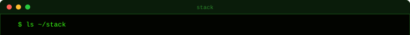

<!-- stack:start -->

<table align="center" border="0" cellpadding="0" cellspacing="0" width="800" bgcolor="#020400">
<tr>
<td colspan="3"></td>
</tr>
<tr>
<td width="35" bgcolor="#020400"></td>
<td width="730" align="left" bgcolor="#020400"></td>
<td width="35" bgcolor="#020400"></td>
</tr>
<tr>
<td colspan="3"></td>
</tr>
<tr>
<td width="35" bgcolor="#020400"></td>
<td width="730" align="left" bgcolor="#020400"></td>
<td width="35" bgcolor="#020400"></td>
</tr>
<tr>
<td colspan="3"></td>
</tr>
<tr>
<td width="35" bgcolor="#020400"></td>
<td width="730" align="left" bgcolor="#020400"></td>
<td width="35" bgcolor="#020400"></td>
</tr>
<tr>
<td colspan="3"></td>
</tr>
<tr>
<td width="35" bgcolor="#020400"></td>
<td width="730" align="left" bgcolor="#020400"></td>
<td width="35" bgcolor="#020400"></td>
</tr>
<tr>
<td colspan="3"></td>
</tr>
</table>

<!-- stack:end -->

<!-- hidden until projects exist:  -->
<!-- projects:start -->
<!-- projects:end -->

